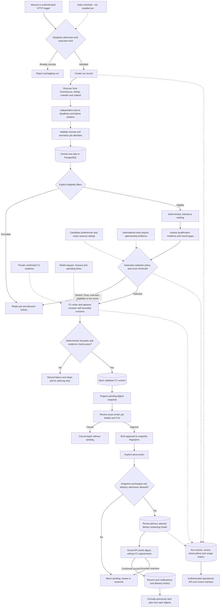
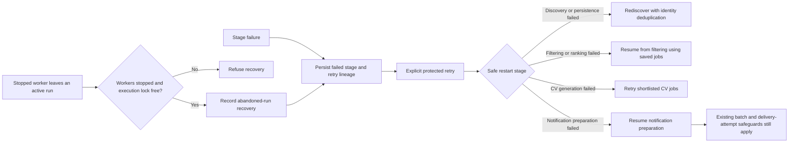
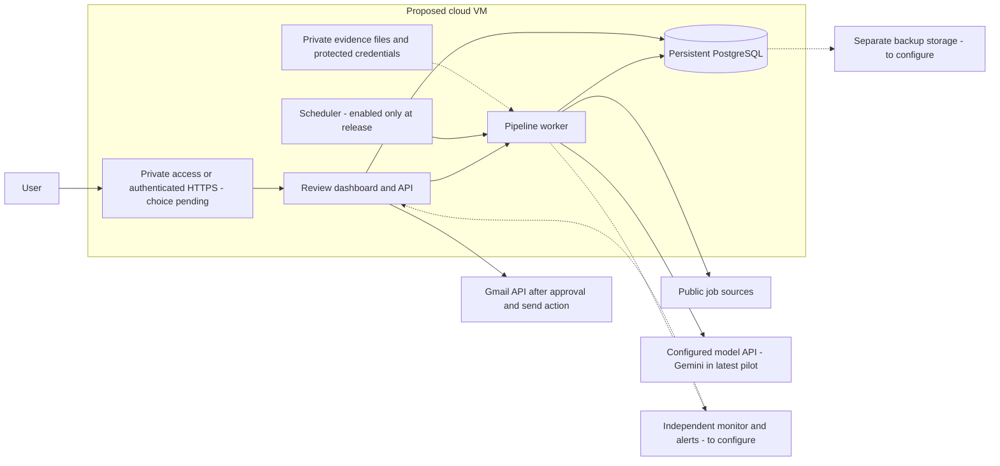

# Current Job Agent Flowchart

Updated October 13, 2026. This describes the validated review-mode workflow on
`phase2-foundation`. Cloud hosting is planned; the scheduler remains disabled.

## Job discovery through approved delivery

- Exact Keep decisions cannot bypass geography or sponsorship checks. An employer's
  affirmative sponsorship policy with a general candidate caveat can qualify, but
  is not a guarantee of individual sponsorship. Unknown or conflicting evidence is held.
- Qualification mentions and relevance scores do not certify proficiency or experience.
- The latest pilot enabled the writer/reviewer while keeping ranking deterministic.
  The optional researcher/analyst model-ranking workflow remains unpromoted.
- The reviewer cannot override deterministic evidence validation. Current validated
  CV output retains source wording and reorders complete sections.
- A run with some failed CV jobs can save a batch for successful jobs while recording
  the overall run as failed for tailoring recovery. Existing open batches are reused;
  a repeated run does not automatically replace or send them.
- Approval and sending are separate actions. An uncertain send must be reconciled
  before any retry; confirmed non-delivery requires renewed approval.
- Explicit automatic delivery exists as an opt-in configuration, but is outside this
  release workflow. Neither agents nor this pipeline submit job applications.

## Recovery flow

Recovery does not unlock a run merely because it is old. Delivery reconciliation
is separate from pipeline retry; retrying a pipeline must not bypass uncertain-send protection.

## Proposed cloud layout — not deployed

Provider, region, budget and access method are pending. Cloud setup still requires
reproducible packaging, durable Gmail authorization, deliberate data migration,
off-machine backup/restore, independent alerts and a cloud acceptance run.
The agent roles share the application runtime; no separate agent servers are required.

## Evidence at the current checkpoint

| Check | Observed result |
|---|---|
| Native discovery | 185 jobs: 73 Greenhouse, 112 Ashby; LinkedIn/Indeed returned zero under the deadline |
| Automatic selection | Four previously user-rated Keep vacancies |
| Live CV checks | Four accepted CVs, 34 Gemini requests |
| Digest | Saved pending; no email or delivery attempt created |
| Replay of the same discovered rows | No duplicate jobs, CVs, batches or delivery attempts |
| Recovery and backup | Stopped-worker recovery and actual local pilot restore passed |
| Validation | 264 local tests and checkpoint CI passed |

This is technical workflow evidence, not a blind international relevance test,
a guarantee of source coverage, or proof of production deployment.
See [Checkpoint 5](CHECKPOINT_05.md), [operations](OPERATIONS.md),
[digest review](DIGEST_REVIEW.md) and the
[sanitized pilot report](../../evals/reports/release_candidate_checkpoint05.json).
