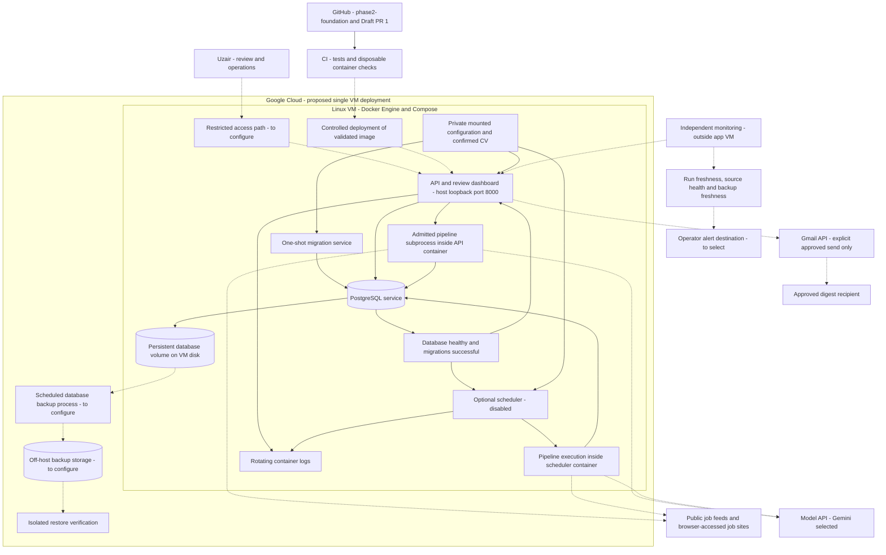

# Infrastructure requirements and deployment flow

Updated November 10, 2026. Google Cloud is the selected target; billing credits,
region, machine size and spending limit are not yet confirmed. **Not deployed.**
This is a separate infrastructure diagram; the application workflow remains in
[CURRENT_FLOWCHART.md](CURRENT_FLOWCHART.md).

## Target infrastructure

Solid connections describe the packaged runtime. Dashed connections describe
infrastructure or integrations that still need cloud configuration and validation.
External APIs already exercised locally still require cloud acceptance.

The pipeline and specialist agents share application processes; they do not need
separate agent servers, a queue service or a GPU. API and scheduler coordinate
through database admission/locking. PostgreSQL has no published host port.
The API binds only to `127.0.0.1:8000`; restricted remote access must be configured
before remote use. No public endpoint or domain is currently provisioned.

## Component requirements and readiness

| Component | Required infrastructure or configuration | Current status |
|---|---|---|
| Compute | One Linux VM capable of running API, PostgreSQL and Chromium; choose CPU/RAM after budget and workload sizing | Not provisioned; free-tier suitability unverified |
| Runtime | Docker Engine and Compose; pinned images and locked application dependencies | Packaged and tested in Linux CI |
| Database | PostgreSQL 16 container, dedicated non-superuser app role, persistent disk and private container networking | Packaged; production disk and history migration pending |
| Migrations | One-shot ordered/checksummed migration service before API startup | Packaged and tested |
| API and review | Non-root read-only container, API token and restricted access path | Packaged; cloud access configuration pending |
| Browser worker | Chromium and OS dependencies in app image; temporary writable space and 512 MB shared-memory allocation per app container | Offline launch passed; live cloud source access unverified |
| Scheduler | Separate optional service, timezone/run time and explicit enable flag | Packaged; disabled until release approval |
| Secrets and CV | Protected files outside Git/image, mounted at startup; API/provider credentials, Gmail credentials and confirmed evidence | Mounts implemented; cloud installation pending |
| External APIs | Outbound access to sources, model API and Gmail; provider quotas/pacing and durable OAuth | Locally exercised; cloud verification and OAuth longevity pending |
| Backups | Scheduled database backups outside VM, retention, restricted storage access and demonstrated restore | Local restore passed; off-host automation pending |
| Monitoring | Independent checks for API health, missed runs, source failures, credential failures and stale backups; alert destination | Not configured |
| Deployment | Validated image, migration procedure, pre-upgrade backup and recoverable prior image | CI and instructions ready; host deployment pending |
| Billing | Confirm credits/expiry, eligible resources, spending agreement and cost monitoring | Unconfirmed; no free-hosting guarantee |

A named Docker volume survives container recreation but does not protect against
VM/disk loss. Rotating logs and Docker restart policies do not replace independent
monitoring or backup verification. File-mounted Compose secrets are not an
encrypted secret-management service. The current package requires review before
email delivery; no applications are submitted.

## Deployment order and remaining gates

```mermaid
flowchart LR
    A[Confirm billing, budget, region and VM sizing] --> B[Provision VM, disk and restricted access]
    B --> C[Install runtime, private settings and CV]
    C --> D[Consolidate pilot history and resolve pending batches]
    D --> E[Start DB, apply migrations and start API]
    E --> F[Configure off-host backups and prove restore]
    F --> G[Configure independent monitoring and alerts]
    G --> H[Verify durable Gmail OAuth and model quotas]
    H --> I[Run cloud acceptance with scheduling off]
    I --> J[Review exact digest and authorize any test send]
    J --> K[Explicit release and scheduling approval]
```

Implementation evidence: [Checkpoint 6](CHECKPOINT_06.md),
[deployment instructions](../../deploy/README.md), and
[Compose configuration](../../deploy/compose.yaml). The checkpoint recorded 266
passing tests plus container checks for authentication, migrations, browser launch,
persistence across restart and the scheduler guard. This is packaging evidence,
not proof of production deployment or cloud capacity.
